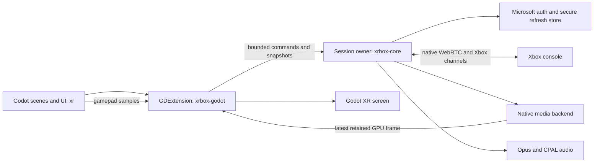

# XRbox architecture

The sole product frontend is Godot/OpenXR, embedding Rust in one process. Keep
one repository with explicit boundaries; no separate core release/versioning or
IPC service is needed at this stage.

- `xrbox-core` owns authentication, discovery, cancellation, bounded queues,
  controller routing and media wiring. It has no Godot dependency.
- `xrbox-godot` translates commands/input/state and owns presentation adapters.
  Workers never receive engine objects; Android GPU imports run on the render thread.
- `xr/` owns scenes, navigation, XR lifecycle and narrow Java platform services.
- `vendor/openxcloud` contains seven pinned libraries. Existing Mac backends and
  upstream GPU utilities stay for provenance/tests; they are not a desktop product.

The standalone egui/eframe 2D client and macOS .app packager were removed by user
request. Git history preserves the validated desktop baseline. macOS development
previews/build tools remain supported; the headset targets are Linux and Android.
Splitting repositories is deferred until an independent consumer or release cycle
justifies versioned public APIs and separate compatibility management.

## Android live implementation — November 12, 2026

Build **0.1.10-xr.2** now includes the first live Android Godot Remote Play path.
This is implemented/build-tested, **not headset or console validated**. The user
requested streaming before the first Quest test, so Android adapters were brought
forward; Linux remains a product target and needs its own decoder/import work.

Godot calls the in-process Rust `Session` through bounded commands. Microsoft
device-code sign-in, secure refresh persistence, discovery and console-only
negotiation reuse the existing core. Godot UI exposes sign-in/copy/browser,
console selection, disconnect/resume and screen controls. No relay or browser
runtime is introduced. Host/Linux Godot previews remain synthetic.

Android startup initializes JNI/CPAL using application context, selects a named
hardware AVC codec, and seals refresh credentials with Android Keystore AES-GCM.
Temporary tokens stay in memory. Android HTTPS uses standard validated TLS with
pinned Mozilla roots. Storage/decoder/import failures surface instead of silently
switching to plaintext credentials or CPU decoding.

MediaCodec outputs PRIVATE ImageReader images. Latest-frame native leases pass to
the render thread for AHardwareBuffer → EGLImage → external OES texture import.
Leases remain alive through GPU fences; bounded retirement may wait when full.
There is no deliberate CPU pixel readback, but actual driver copies, color/crop,
latency, pacing and energy cost require device measurements. Audio uses upstream
Opus/CPAL. Godot gamepad samples feed the existing deferred shortcut recognizer;
physical Guide remains host-reserved. Focus loss disconnects active streaming.

Next gate: follow [xr/ANDROID.md](xr/ANDROID.md) on Quest 3S with a real Xbox.
Validate actual moving video, audio, controls, storage, lifecycle and XR separately.
Do not infer successful presentation from packet, decode or GPU import counters.
Full XR settings/hotkey editor, passthrough, Linux hardware media, Flatpak and
battery optimization remain later work. No hardware performance claims are made.

## Shared session guarantees

The session owner runs Tokio on a dedicated thread; UI commands and input queues
are bounded. Auth jobs are cancellable and stale results cannot activate a new
session. Only refresh credentials persist; temporary credentials stay in memory.
No credentials are written to settings. Console-only acquisition and signaling
reuse upstream code; no cloud application crate is included.

Streaming readiness requires peer connectivity, input readiness and newly decoded
video. Latest-frame mailboxes prevent an accumulating presentation queue. Audio
uses bounded PCM output. Focus loss/disconnect neutralizes input and tears down
media; teardown never blocks the Godot UI thread.

Select/View and Start/Menu are deferred bindings, including singles. Resolve the
most specific completed chord when the initiating button is released. Physical
Guide stays host-reserved. After menu resume, only Select/Start wait for release;
other held gameplay inputs resume immediately.

Diagnostics expose sanitized categories/counters, never tokens, raw responses,
SDP or addresses. Relay routes are rejected; private ICE addresses alone do not
prove direct LAN routing. Linux hardware decoding/import, release packaging and
battery behavior remain independent hardware gates.
