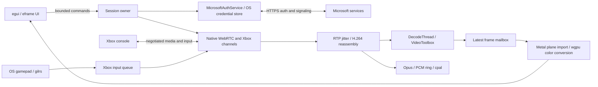

# XRBox architecture

One native process, one window, one active Xbox home session. `crates/xrbox`
contains the application; seven pinned OpenXCloud library crates supply the
protocol and media stack. No upstream cloud application UI is included.

## Ownership and flow

`app` (main.rs) owns egui and GPU objects on the UI thread. `session` owns a
Tokio runtime on a dedicated owner thread, accepts bounded typed commands and
publishes a small shared status snapshot. Long auth requests run in cancellable
jobs. Cancelling waits for the job to stop before changing credentials or accepting
another attempt, so an old result cannot activate a later session. There is one
active transport/orchestrator and one per-session decoded-frame mailbox.

`auth` chooses xhome credentials explicitly. Its home-only upstream extension
never requests cloud offerings. Device-code polling supports pending, expiry,
denial, cancellation, and slow_down. `KeyringTokenStore` uses service `xrbox`;
secure persistence is enabled by default, with refresh/discovery at startup on the
session worker. The user can choose session-only `MemoryTokenStore` before signing
in. An empty store stays at sign-in without network requests; refresh/store errors
are shown and never erase saved credentials silently. Successful device-code sign-in
also discovers consoles automatically. Smoke tests bypass restoration entirely.
No credential file exists.

The patched session orchestrator accepts either Provisioned directly or
ReadyToConnect -> transfer token /connect -> Provisioned. It then performs the
existing SDP/ICE exchange and channel handshakes. XRBox reports Streaming only
with peer connectivity, input readiness, and newly decoded video. Retry-start
records a decoded-frame baseline so old decoded frames cannot satisfy readiness.

`media` installs NativeMediaPipeline on the transport worker. H.264 access units
feed the bounded upstream DecodeThread; its latest-frame mailbox avoids an
accumulating presentation queue. macOS VideoToolbox outputs IOSurface-backed
CVPixelBuffers; xcloud-gpu imports their Metal planes, converts color, and presents
without a deliberate CPU readback. GPU completion retains frame resources through
upstream VideoRenderer. All upscalers are bypassed.

Opus decodes into upstream AudioOutput's bounded PCM ring and cpal output callback.
The owner polls device replies; output counters report drops. Input samples every
8 ms only during an active session; upstream channel scheduling sends the queue.
Focus loss and disconnect enqueue neutral state. Input routing is in session.rs
rather than a separate input module because it has no XRBox-specific mappings.

Disconnect aborts outstanding auth work, neutralizes input, stops keepalive,
closes the peer, resets media, clears the frame source, and permits a short bounded
server cleanup window. Upstream close operations have their own timeout. Process
exit joins the owner off the async runtime and shuts down Tokio with a timeout.

## Diagnostics and platform boundary

Only the `xrbox` tracing target is enabled. Upstream raw logs may contain SDP,
addresses, response bodies or account identifiers, so they are not enabled by an
environment override. App error formatting emits categories/status codes, not
raw upstream bodies. Controlled stage logs rotate at startup after 1 MiB.
The nominated ICE pair is sampled off the input/UI thread every five seconds.
Only its route classification reaches the app; addresses never do. Relay routes
cause teardown. Private addresses suggest LAN but do not prove network topology.
Unavailable route information remains unknown.

Desktop rendering consumes upstream Frame/FrameMailbox; the Xbox/session layer
has no egui/OpenXR dependency. A future Frame backend must extend the Linux
native frame representation and import/synchronization path for an actually
accessible hardware decoder. Linux CPU NV12 upload is not zero-copy. First test
the ordinary window on Frame's system screen; add a minimal OpenXR quad presenter
only after desktop and headset streaming acceptance. Do not build XR now.

## Decisions and differences from Plan.md

- Vendor all seven required crates together instead of mixing Git and patched
  package sources. See vendor/README.md and Cargo.lock.
- Use the existing thread-safe snapshot/frame mailbox rather than a watch channel;
  command queue is bounded, media never travels through UI messages.
- One owner loop samples input while active; no additional sampling thread is
  needed. Upstream WebRTC/decoder/audio threads are retained.
- No FFmpeg macOS fallback in the default app, keeping its .app self-contained
  with only system dynamic libraries. Unsupported decoding is a visible failure.
- Secure persistence defaults on; no automatically configured Linux secret service.
- CPU/memory sampling and richer diagnostic exports remain follow-up work.
  Selected-route observation is implemented, but console/LAN and battery behavior
  remain unverified until hardware testing.

## Video stall handling (0.1.1)

The media adapter publishes reassembly, decoder-output, error, queue-drop and
keyframe-gating counters once per second. The owner compares decoder progress
with monotonic time. After three seconds without a decoded frame it requests
recovery with a three-second minimum interval; after fifteen seconds it tears
down the stalled session instead of leaving the last image labeled Streaming.
The upstream jitter buffer now drains expired entries before rejecting a new
timestamp when its bounded queue is full. UI diagnostics distinguish assembled,
decoded and presented frames. The upstream drop counter counts incomplete frames,
so XRBox labels it accordingly instead of claiming it is lost network packets.

## Native clipboard integration (0.1.3)

The eframe dependency disables default features, so native `clipboard` support
must be explicitly enabled. Without it, egui-winit accepts CopyText commands but
only updates an internal string; the OS clipboard is unchanged. Enable eframe's
clipboard feature to route the existing user-initiated copy command through its
native backend (arboard on macOS, with Wayland support resolved for Linux).

## Reduce persistent credential operations (0.1.4)

An application-owned TokenStore adapter delegates refresh-token storage to the
existing cached KeyringTokenStore while keeping MSA access tokens, stream tokens
and LPT/expiry in MemoryTokenStore. Upstream token exchange APIs are unchanged.
Refresh rotation is saved synchronously before the exchange reports success;
storage errors remain visible. Legacy bundles remain readable, without a migration
that deletes credentials. Previously persisted temporary fields are untouched
until sign-out. Sign-out clears transient and durable state, once for the current
persistent service. No token is moved into a plaintext file.

The packager optionally accepts an existing signing identity, retaining ad-hoc
signing by default. No certificates, trust policy or OS defaults are modified.

## Controller-first presentation (0.1.5)

`controller.rs` shares one native sampler, latest raw state and stream-menu flag
between the session owner and UI. Sampling runs on the session thread: 33 ms when
idle and the existing 8 ms streaming tick when active. The stream input source
reads that cached sample instead of constructing a second physical sampler.
Game input updates do not request extra presentation frames while menus are closed.

View+Menu is edge-triggered while focused. Opening the menu makes the game sampler
return neutral state; after closing, only View/Menu are masked until both are
released. Other inputs resume immediately, as explicitly requested by the user.
The first hotkey button may be forwarded before the complete chord is sampled.
Existing focus-loss handling remains in the upstream input source.

`navigation.rs` owns spatial focus over enabled tile rectangles, A/B edges, stick
thresholds, and held-direction repeat (400 ms initial / 150 ms subsequent). Menu
focus changes disarm held UI selections until neutral so a held A does not activate
a new screen; this UI rule does not gate gameplay on resume. Actions use stable IDs
so changing Copy feedback or status text does not shift selection. New screens
focus their primary tile. Sign-out is confirmed. No Xbox protocol changes are made.

## OS-independent Guide shortcuts (0.1.6)

Supersedes 0.1.5's menu hotkey: View/Select+Menu/Start sends remote Guide;
View+Menu+LB+RB opens XRBox. The two-button candidate commits only when View or
Menu is released. As long as both remain held, adding the bumpers gives the larger
chord priority regardless of press order, without a timeout that could fire Guide
while attempting the app shortcut. A completed app shortcut cancels any pending
Guide. The reserved pair is suppressed until fully released after recognition.
Unrelated controls continue immediately after closing the menu, including bumpers.

The session thread runs a deterministic shortcut state machine before the existing
input source. It produces a 120 ms NEXUS pulse followed by a release. Focus loss,
controller disconnect, idle state or an open app menu cancels candidate/pulse state.
Both reserved buttons must be released before rearming on focus return/reconnect;
other held controls are not gated. Physical NEXUS is stripped from input. This
never generates host OS input events and does not claim/suppress host system
shortcuts. The bundled SystemGestureGuard remains unused: Apple's foreground
preference is not a portable guarantee, and host defaults must remain unchanged.

Tests cover all 24 press orders for the four-button shortcut, one-shot/release
semantics, timing, focus/disconnect cancellation, immediate non-shortcut controls,
raw physical Guide filtering, shared-controller menu priority, and actual protocol
packet press/release encoding. Headless egui tests also exercise keyboard actions
and prevent activation of disabled modal backgrounds.

## Deferred Select/Start bindings (0.1.7)

Supersedes 0.1.6's partial-chord passthrough. A single ordered binding table contains
Select, Start, Select+Start (Guide), and Select+Start+LB+RB (XRBox). The first sampled
Select/Start press starts a pending gesture and all raw Select/Start bits are masked.
The highest-priority complete binding seen while the initiating button remains
held is latched. Only release of that initiating button commits it, even if other
buttons were released first. A simultaneous sampled pair deterministically uses
Select as the initiator. No single-button fallback gets its own recognizer.

Protocol actions use the same 120 ms pulse path. A bounded queue (16 pending
presses) and at least one 8 ms release interval preserve rapid repeated presses;
queue overflow is dropped with a sanitized warning. An app-menu action cancels
pending pulses; focus loss/disconnect/idle/open menu resets all recognizer and
queue state. Only Select/Start must release before rearming; unrelated inputs
remain immediate. This intentionally replaces held Select/Start with short presses
on release. Bumper input remains unbuffered.

Regression tests enumerate 24 press orders by 24 release orders for app-menu
priority, both press/release orders of the Guide chord, deferred singles, rapid
repeated taps, bounded queue/cancellation, ordinary-input passthrough, and the
actual protocol packets for singles, Guide and the app menu. Pending combined
gestures produce no Select/Start packets before or after resolution.

## Stable hover and focus scrolling (0.1.8)

Navigation previously requested centering of the focused tile every frame. That
could override pointer-driven scrolling and repeatedly move/clamp content while
hover triggered repaints. Focus changes now enqueue one reveal request, consumed
when the matching tile renders; unchanged focus does not reissue it. Reveal uses
minimal scrolling rather than centering. The version/Remote Play text lives in the
fixed bottom panel rather than the scrollable page.

Headless tests verify stable user scroll position during stationary hover, that a
new offscreen focus is still revealed, and that repeated focus assignment does not
lock scrolling. This removes a reproduced source of scroll movement; final
confirmation of the reported visible text flicker remains a user UI check.
