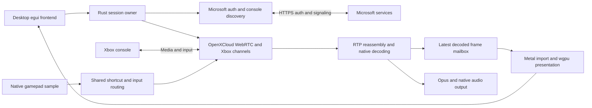
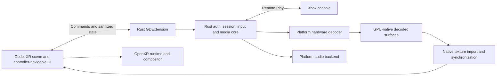

# XRBox implementation plan

Updated: November 11, 2026. Current source: **0.1.10**.

The detailed Godot implementation/build sequence is in [XR_PLAN.md](XR_PLAN.md).
This file tracks overall decisions, progress and product acceptance gates.

## Current decisions

The desktop proof of concept is implemented in native Rust and the user has
reported successful Xbox playback. **Godot is the selected XR frontend**, following
the user's explicit decision. Keep the Rust/OpenXCloud streaming core and integrate
it into Godot through an **in-process Rust GDExtension**. Do not rewrite Xbox
protocols or replace the core with Godot's own WebRTC implementation.

Ship two first-class headset targets from the shared Godot project and Rust core:

1. **Steam Frame: native Linux ARM64 application.**
2. **Android ARM64 APK: Meta Quest first, with additional Android OpenXR headsets
   added through export presets, capability checks and per-device validation.**

An APK is an explicit deliverable, not merely a possible fallback if Linux fails.
Steam Frame's Android/Lepton execution path may also be evaluated, without
substituting it silently for the Linux target. Linux ARM64 and Android ARM64 use
separate native builds/ABIs; their shared libraries are not interchangeable.

This replaces the earlier recommendation to choose a handwritten native OpenXR
frontend or build custom XR only if necessary. Godot is chosen; **decoder backends,
renderer/texture integration and efficiency remain measured engineering choices**.
An ordinary system-screen run or minimal native presenter can be a diagnostic
baseline, not a competing product frontend. Do not build two XR frontends by default.

Product constraints remain:

- Xbox Series X/S **console Remote Play**, one active stream. No cloud gaming.
- One installed application per device. No relay PC, Node/Electron/browser media
  runtime, external streaming server or separately managed service.
- Microsoft account authentication/signaling may use internet services. Inspect
  the selected media route; a private ICE address alone does not prove direct LAN.
- Target 1080p60 where supported, stable pacing, low latency, hardware decoding,
  minimal unnecessary copies and low CPU/power overhead. These are targets.
- Gamepad-first menus and Bluetooth Xbox controller gameplay. No motion-controller
  gameplay, hand tracking, social features, game catalogs or complex environments.
- Optional passthrough only after runtime support is verified. Start with one
  configurable cinema screen and a simple background; no image enhancement passes.
- Never change the user's PATH, global toolchain, default apps or system settings.
  Keep SDK/toolchain paths explicit or command-local. Do not install tools,
  access saved credentials, launch real sessions or publish builds automatically.

## Progress and evidence

| Area | Current state | Remaining acceptance |
| --- | --- | --- |
| Native desktop streaming | Rust client, home-only auth/discovery/negotiation, VideoToolbox/Metal video, Opus audio, controller input and cleanup implemented; user reports desktop playback works | Sustained reliability, selected route and performance evidence remain separate checks |
| Authentication UX | Secure default restoration, refresh-only persistence, session-only option, sign-out, clear device code and native Copy action | Recent credential-store behavior still has manual tests in VALIDATION.md |
| Reliability and diagnostics | Reproduced jitter-buffer freeze fixed; assembled/decoded/presented counters, stall recovery/timeouts, route classification and sanitized logs implemented | No new end-to-end latency, power, Frame or Android results |
| Controller/UI | Deferred singles and chord hotkeys, configurable Guide/menu bindings, recording/reset, neutral menu routing and immediate unrelated inputs on resume | Physical timing and custom mappings need user retest |
| Fullscreen/settings | Native fullscreen, clean video-only presentation, fit/stretch/zoom, requested resolution, mute, deadzone/inversion/A-B swap and atomic non-secret settings persistence implemented | Native window transitions and live settings need hardware validation |
| Header layout | Compact vector glyphs/small labels, responsive non-overlapping actions and focus-scroll fix implemented | Final appearance on the user's display |
| Repository/tooling | Cargo lock/toolchain pins, seven vendored libraries, GPL notices, Makefile, docs, macOS packaging and daily Dependabot config committed | Hosted CI and actual Dependabot execution not established by local configuration |
| Godot XR | Frontend decision accepted; integration not implemented | GDExtension, XR scene, native texture integration and on-device tests |
| Steam Frame Linux ARM64 | Target selected; not built or tested | Deployment/runtime, hardware decoder, GPU import, input/audio/storage and power |
| Android APK / Meta / other headsets | Target added to this plan; no APK built or tested | Android native dependencies/adapters, export/signing and device acceptance |

Latest executed application checks: **44 app tests passed**, formatting and
Clippy passed with warnings denied (0.1.10). The 0.1.9 work also exercised the
broader API/auth, input and session suites; OS-Keychain integration remains an
explicitly ignored/manual test. See VALIDATION.md for exact runs and limitations.
Earlier upstream audit counts below are not XRBox test counts.

Desktop additions by milestone:

- 0.1.1: home-session integration fixes, video-jitter freeze recovery and stall
  diagnostics; user subsequently reported playback working.
- 0.1.2–0.1.4: authentication restoration, native clipboard support and fewer
  unnecessary Keychain writes; optional existing signing identity for packaging.
- 0.1.5–0.1.7: controller-first UI and deferred shortcut recognition. Defaults:
  Select/View+Start/Menu sends remote Guide; adding LB+RB selects XRBox menu.
  All bindings resolve when the first Select/Start pressed is released; combined
  gestures do not leak individual Select/Start presses. Other controls stay live.
- 0.1.8–0.1.10: fixed hover/focus scrolling, fullscreen/settings/custom hotkeys and
  compact header actions. Default chord tests cover 24 press x 24 release orders;
  newer tests cover configuration, native command/layout output and UI activation.

Source version, built executable and packaged app may differ. `make build` updates
an executable; `make package` updates dist/XRBox.app. Do not imply that a source
change updated the bundle. Recent tasks intentionally skipped packaging/launching.

## Historical research baseline

Pin OpenXCloud revision `982d2a058c51b5f1285bba90f485bd599a3c2bc0` rather than a moving branch:

https://github.com/shyim/openxcloud/tree/982d2a058c51b5f1285bba90f485bd599a3c2bc0

These results describe the original, unmodified upstream audit. They are not current XRBox or headset results. The temporary audit checkout is not a project dependency; current provenance and patches are in vendor/README.md.

Executed on the Apple Silicon Mac:

- `cargo build --locked -p xcloud-app`: passed.
- `cargo test --locked --workspace --all-targets --all-features`: 701 passed, zero failed, three ignored.
- `cargo clippy --locked --workspace --all-targets --all-features -- -D warnings`: passed.
- `cargo fmt --all -- --check`: passed.
- `OPENXCLOUD_MEMORY_TOKENS=1 target/debug/openxcloud --smoke`: zero failures.
- `cargo run --locked -p xcloud-media --example decode_file`: synthetic 1920x1080 video decoded using hardware; 120/120 frames, zero drops or callback errors, including the paced 60 FPS run.

Ignored tests require OS-keychain access, physical audio playback, or a manual performance benchmark. These results do not establish live authentication, real console streaming, controller operation, Linux ARM64 compatibility, or Frame battery life.

Important source findings:

- Authentication, console discovery, home-session request construction, WebRTC, Xbox data channels, Opus audio, controller input, and decoder interfaces exist in Rust crates.
- The desktop application launches cloud streams and prefers cloud credentials. It is not a ready-made console Remote Play frontend.
- The orchestrator performs the ReadyToConnect token exchange only in its cloud branch. Its home branch must be reconciled with the console sequence demonstrated by Greenlight and xbox-xcloud-player.
- The orchestrator can report Connected after the peer connection wait expires without an actual connection. XRBox must not use that status alone as proof of playback.
- Linux supports an FFmpeg VA-API path with CPU readback. Native frame types and GPU import support GPU-resident frames on macOS, but Linux uses CPU-backed NV12 and texture uploads.
- Linux persistent credentials use Secret Service through the keyring dependency. Availability on Frame is unverified.
- Upstream pins Rust 1.99.1, includes Cargo.lock, and declares GPL-3.0-only. Preserve license notices and use GPL-3.0-only for derived XRBox code, subject to a complete dependency and provenance review before distribution.

Reference implementations:

- OpenXCloud: https://github.com/shyim/openxcloud
- Greenlight: https://github.com/unknownskl/greenlight
- xbox-xcloud-player: https://github.com/unknownskl/xbox-xcloud-player
- PSBox: https://github.com/RafaelNGP/psbox-cloud-gaming
- Valve Steam Frame documentation: https://partner.steamgames.com/doc/steamhardware/steamframe

PSBox remains a native protocol reference and fallback. Its inspected desktop media path also reads hardware-decoded frames into CPU memory, so switching would not by itself solve Frame efficiency. xbox-xcloud-player requires browser media APIs; it is not the primary architecture given the decision to exclude Electron.

## Architecture: implemented desktop and selected XR target

### Implemented desktop

One Rust executable uses egui/eframe for the desktop window, wgpu for presentation,
Tokio for auth/signaling, OpenXCloud's WebRTC/channel stack, VideoToolbox hardware
decoding on macOS, Opus/cpal audio and a shared native controller sampler. The
system browser is used only for supported Microsoft device-code authentication.

All seven library crates are vendored together at the audited revision, preserving
one package identity and the upstream layout. The original Git-dependency/partial
Cargo patch proposal was superseded; Cargo.lock and vendor/README.md describe the
actual build and narrow patches. No cloud-oriented xcloud-app crate is included.

| Current module | Responsibility |
| --- | --- |
| main.rs | Desktop composition root, egui UI and wgpu objects |
| auth.rs | Token-store choice, refresh-only persistence and home credentials |
| session.rs | Bounded commands, cancellable auth/connect jobs, one session and teardown |
| media.rs | Upstream RTP/decoder/audio wiring, mailbox and counters |
| controller.rs | One sampler, menu/game routing, deferred/configurable shortcuts |
| navigation.rs / toolbar.rs | Controller focus/repeat, compact desktop actions |
| config.rs / settings_ui.rs | Validated non-secret settings, draft/capture UI and background saves |
| presentation.rs | Native fullscreen state and fit/stretch/zoom geometry |
| diagnostics.rs | Controlled, sanitized logs and visible measurement limits |

The owner runs a Tokio runtime on a dedicated thread. It cancels and awaits old
jobs before replacing attempts, rather than implementing the previously proposed
watch channel/generation-ID scheme. Shared snapshots and bounded commands carry
control state; media stays in its mailbox/ring. Sampling uses the owner loop, not
a separate new sampling worker: 33 ms idle and 8 ms active. Configuration changes
do not cancel authentication or erase the in-progress device code.

Current integration still passes egui contexts to some session/media paths for
repaint notifications. It is **not yet an engine-independent library**. Remove
that UI coupling while extracting the reusable core for the real Godot prototype;
retain the desktop client as a regression harness. Do not claim a bridge already
exists or add speculative abstraction crates before the extraction is needed.

### Selected Godot + Rust architecture

- **Godot owns presentation:** OpenXR session/lifecycle, screen placement/size,
  recentering, spatial menus, supported composition layers and optional passthrough.
  Keep the first scene minimal. Do not run a competing Rust OpenXR session.
- **Rust owns streaming:** Microsoft authentication, console discovery, home-only
  negotiation, WebRTC/channels, H.264/Opus integration, controller routing, hotkeys,
  settings models, diagnostics and bounded cleanup.
- **GDExtension is in-process:** build a native library for each target and package
  it with the Godot application. Use godot-rust bindings after checking/pinning a
  compatible Godot/binding version. A narrow Android/JNI plugin is acceptable for
  platform APIs; it is not a runtime server or separate application.
- **Control bridge:** typed commands and sanitized snapshots/events. Do not put
  credentials, raw SDP/ICE or video/PCM arrays into script properties or JSON.
  Worker callbacks notify Godot safely; scene/render APIs run on their required
  threads. Rust remains the single owner of session and teardown state.
- **Media bridge:** exchange retained native surface/texture resources with explicit
  readiness/completion synchronization and lifetime rules. Godot must not receive
  CPU pixel arrays every frame. A GPU conversion/copy can be acceptable; efficient
  texture access and stable pacing must be demonstrated, not assumed.
- **UI migration:** rebuild XR menus with Godot controls using the same settings,
  actions and core state. Keep deferred Select/Start, custom chords, A-select/B-back,
  recording validation, focus/disconnect neutralization and immediate non-shortcut
  inputs on resume. Keep the desktop frontend until the XR path is validated.

Godot's **Mobile renderer is the starting candidate**, not an unconditional choice
for every headset. Evaluate Android Compatibility/OpenGL where device/loader or
codec-surface integration requires it; Godot's Android XR documentation currently
also warns about Mobile/Vulkan configurations. Pin the tested renderer per export
target after proving the media path. Engine choice is settled; backend selection
must not force avoidable CPU readback or unsupported runtime behavior.

Use a quad composition layer for the cinema screen where the target runtime and
Godot path support it; measure a mesh-screen fallback if needed. Composition layers
are not automatically cheaper on every runtime. Reuse video textures when possible
and update menu content on demand, while obeying the runtime's XR frame loop and
pose requirements. Do not blindly cap the headset loop to the video's 60 FPS.

### GPU interoperability gate

Neither a Godot native-texture API nor a wgpu texture handle proves interoperable
playback. Verify GPU device ownership, formats/modifiers, external memory/import,
color conversion, fences/semaphores, queue ownership and frame retention until GPU
completion. Do not assume VkImage handles from different devices are interchangeable.

The current macOS path preserves VideoToolbox IOSurfaces through Metal/wgpu. The
Linux path currently uses FFmpeg-backed decoding with CPU-backed frame/upload
limitations. Android currently falls into non-macOS FFmpeg selection in XRBox; that
is **not an Android MediaCodec implementation**. Replace/refactor platform selection
only as confirmed target backends are implemented, preserving the decoder/frame
interfaces and compressed-frame recovery rather than rewriting Xbox transport.

### Targets, packaging and platform adapters

| Target | Planned artifact | Platform work / acceptance |
| --- | --- | --- |
| macOS Apple Silicon | Existing native desktop executable/.app; optional Godot development harness | Preserve current streaming behavior and hardware decode; macOS Godot testing alone does not prove headset compatibility |
| Steam Frame Linux ARM64 | Godot Linux ARM64 export + matching Rust native extension | Validate Valve runtime/deployment, accessible hardware decoder, native GPU import, audio/input/credential storage and power |
| Meta Quest | Signed Android arm64-v8a APK + aarch64-linux-android Rust extension | Validate OpenXR loader/vendor setup, MediaCodec surface path, Android lifecycle/input/audio/storage and real Remote Play |
| Other Android OpenXR headsets | Shared source with generic or device/vendor APK export presets as needed | Confirm runtime/extensions and hardware behavior per model; do not advertise universal headset support |

APK work includes:

1. Pin compatible Godot/export templates, Rust bindings, vendor plugin/loaders,
   Android SDK/NDK, JDK/Gradle and native dependencies. Linux and Android libraries
   are separate builds even though both use ARM64. Document explicit tool paths;
   do not modify global PATH/toolchains or silently install prerequisites.
2. Export a working debug APK first and install through the supported developer
   workflow. Keep debug/release signing separate; never commit signing keys,
   passwords or machine-specific SDK paths. Store publication is a later decision,
   not authorization to create accounts or publish releases now.
3. Start with Android MediaCodec hardware H.264 decoding to a Surface. Investigate
   Surface/native-buffer import into the chosen Godot renderer (for example an
   AHardwareBuffer/Vulkan or EGL path only where supported). Confirm the actual
   decoder and synchronization. CPU readback is a diagnostic fallback, not proof
   of the efficient production pipeline.
4. Audit Android compilation of current native dependencies, especially input,
   keyring, audio, Opus and media crates. Do not assume desktop gilrs/Secret Service
   or an existing FFmpeg dependency is an Android-ready implementation. Add narrow
   adapters or feature selection where required.
5. Keep one input owner. Feed platform/Godot or native Android controller events
   into the Rust raw-state/shortcut path; do not sample independently in both
   engines or tie packet timing accidentally to scene rendering. Bluetooth pairing
   stays with the OS. Physical Xbox/Meta/system buttons remain OS-owned.
6. Keep audio owned by the core using a tested native backend or narrow platform
   adapter. Avoid a duplicate Godot audio pipeline and extra PCM queues. Validate
   headset output, mute/unmute, focus loss, suspend/resume and device removal.
7. Implement TokenStore using Android Keystore-protected encryption for persisted
   refresh credentials in app-private storage, or use a clearly labeled memory-only
   session until that exists. Keystore protects keys; do not pretend it directly
   stores arbitrary bearer tokens. No plaintext token files or repeated temporary
   token persistence. Preserve supported device-code/browser sign-in, including
   entering the code on another device if the headset browser is unsuitable.
8. Handle app pause, headset removal/sleep, OpenXR focus changes, browser switching,
   process recreation and network loss. Release controls immediately; cancel or
   resume work explicitly without replaying stale auth/session/input events.
9. Use only required network/runtime permissions and inspect network/security
   behavior. Do not require root, modify system hotkeys, bypass authentication or
   add a PC/phone to the runtime media path. A phone used for device-code sign-in
   is not a streaming relay.

Use shared OpenXR features where available and select vendor extensions at runtime.
Meta passthrough/foveation capabilities do not establish support on Steam Frame or
other Android devices. Enable passthrough only when a tested extension path exists;
keep a usable plain-background mode everywhere.

## Remaining milestones and acceptance gates

### 1. Close recent desktop regressions — implemented, user retests pending

Preserve the working desktop stream. Use the manual procedures in VALIDATION.md
for recent auth, fullscreen, settings, custom hotkeys and compact toolbar changes.
Do not equate tests, a connected signaling state or received packets with usable
video/audio/input. Inspect actual selected routes and sustained reconnect behavior.
No additional app packaging/launch is required merely to update this plan.

### 2. Extract the core and build the smallest Godot XR prototype

When implementation resumes, extract only the core modules needed by a real
GDExtension. Replace egui repaint coupling with engine-neutral notifications; keep
protocol ownership, settings and regression tests intact. Choose/pin the engine,
Rust bindings and export templates, then build one minimal XR scene with a
repositionable screen and controller-navigable test UI. Start with synthetic content
and a functioning native bridge, not a speculative full application scaffold.

Acceptance: supported OpenXR initialization, native extension loading and clean
shutdown on Steam Frame Linux ARM64 and a Meta Quest Android debug APK. Record
actual OS/runtime/device/build versions. These targets can be brought up in either
order; the APK must remain an explicit deliverable. Mac editor success is not
headset or Android success. Do not migrate the full desktop UI yet.

### 3. Prove native decode-to-Godot presentation on each platform

Use local synthetic H.264 clips with known resolution/FPS to isolate hardware
codec access and native texture interchange from Xbox/network issues. Implement
one confirmed backend at a time, preserving bounded queues and latest-frame
presentation. Test color, stride/formats, synchronization, dropped frames, repeated
resolution changes, buffer release and device/app lifecycle recovery.

Acceptance: named hardware decoder, documented native-surface path, measured CPU/
GPU work and stable paced presentation, no accidental per-frame CPU readback/upload
bridge, and no accumulated frames/resources. Record any unavoidable copies honestly.
If a particular Godot renderer/import path fails, investigate another compatible
backend within the chosen Godot frontend before reopening architecture decisions.

### 4. Integrate real Remote Play and migrate the essential XR menus

Expose supported sign-in/discovery/connect/disconnect/settings through the bridge.
Keep refresh tokens in platform secure storage and media/input in the native core.
Port only required menus: sign-in/code/copy, console tiles, stream menu, display/
XR settings and diagnostics. Preserve controller-first navigation and configurable
hotkeys. Add screen size/distance/placement/recenter and optional supported passthrough.

Acceptance per target: real Xbox video/audio/controller input, correct route
classification, fullscreen/cinema presentation, focus and hotkey behavior, settings
persistence, bounded disconnect/reconnect and headset suspend/resume. Have the user
run hardware/account tests; stop at that boundary rather than inventing results.

### 5. APK compatibility, packaging and efficiency

Produce reproducible Linux ARM64 packages and signed Android APKs with all required
native libraries. Validate Meta first, then add actual other-headset test results
before claiming support. A generic APK may be possible for supported runtimes,
but keep vendor/device presets available; do not promise one APK works everywhere.
Expand dependency automation to Godot/plugin/Android build components once present.
No GitHub Actions workflow currently exists; add meaningful build/tests when those
targets are implemented, without claiming unexecuted CI success.

Measure matched, unplugged headset trials: idle baseline, local representative
video and real Xbox playback. Hold firmware, brightness, volume, refresh rate,
stream quality, network and thermal starting state constant. Record decoder,
CPU/GPU load, dropped frames, frame pacing, available latency/power/temperature and
memory counters. Evaluate passthrough separately. Run on the actual target headset;
desktop metrics and Godot support documentation cannot predict battery life.

Keep the 60 FPS stream target independent of headset refresh. Avoid unnecessary
physics, lighting, shadows, post-processing, upscaling, animated rooms and continual
menu rendering. Optimize based on measurements; do not silently lower quality.

## Next action after this planning update

Finish user acceptance of recent desktop changes, then implement a narrowly scoped
**Godot + Rust native-extension XR/deployment prototype**, including a **Meta Quest
Android ARM64 APK** and **Steam Frame Linux ARM64** bring-up. Prove hardware video
presentation before a full UI migration or environment work. No Godot project,
GDExtension, APK, Frame build or new benchmark is created by this documentation task.

## Primary platform references

- [Valve: Godot on Steam Frame](https://partner.steamgames.com/doc/steamhardware/steamframe/engines/godot)
- [Godot XR setup and renderer guidance](https://docs.godotengine.org/en/stable/tutorials/xr/setting_up_xr.html)
- [Godot OpenXR composition layers](https://docs.godotengine.org/en/stable/tutorials/xr/openxr_composition_layers.html)
- [Godot native texture import](https://docs.godotengine.org/en/stable/classes/class_renderingserver.html#class-renderingserver-method-texture-create-from-native-handle)
- [Godot Linux exports](https://docs.godotengine.org/en/stable/tutorials/export/exporting_for_linux.html)
- [Godot Android XR deployment and vendor presets](https://docs.godotengine.org/en/stable/tutorials/xr/deploying_to_android.html)
- [godot-rust Android native-extension builds](https://godot-rust.github.io/book/toolchain/export-android.html)
- [Godot OpenXR Vendors: Meta](https://godotvr.github.io/godot_openxr_vendors/manual/meta/index.html)
- [Android MediaCodec](https://developer.android.com/reference/android/media/MediaCodec)
- [Android controller input](https://developer.android.com/games/sdk/game-controller/controller-input)
- [Android Keystore](https://developer.android.com/privacy-and-security/keystore)
