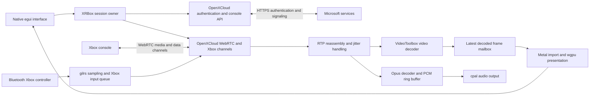

# XRBox implementation plan

Date: November 11, 2026

## Decision and first milestone

Build a minimal native Rust Xbox console Remote Play client using OpenXCloud's reusable crates. First validate direct streaming on the Apple Silicon development Mac. Stop for the user's real Xbox test before implementing XR presentation or Steam Frame decoder integration.

XRBox is a promising project, not a validated Steam Frame streaming solution. Desktop console compatibility and headset efficiency are separate acceptance gates.

Product constraints:

- One packaged application. No separately installed Node runtime, background services, relay PC, or intermediary streaming server.
- Xbox Series X/S console Remote Play only. Microsoft authentication and signaling may use internet services; the selected media connection must be inspected to establish whether it is direct on the LAN.
- Electron is excluded. Rust is preferred for most of the application; native bindings are acceptable where required.
- Use Steam Frame's system virtual screen for the first headset milestone if compatible. Custom OpenXR follows successful streaming validation.
- Target 1080p60 where supported, stable pacing, low latency, and efficient hardware decoding. These are targets, not guarantees.
- No cloud gaming, game catalog, social features, complex environments, hand tracking, frame generation, or optional upscaling in this milestone.

## Research baseline

Pin OpenXCloud revision `982d2a058c51b5f1285bba90f485bd599a3c2bc0` rather than a moving branch:

https://github.com/shyim/openxcloud/tree/982d2a058c51b5f1285bba90f485bd599a3c2bc0

The unmodified revision was checked in `/private/tmp/xrbox-openxcloud-audit`. This temporary directory and its logs are audit conveniences, not required project dependencies.

Executed on the Apple Silicon Mac:

- `cargo build --locked -p xcloud-app`: passed.
- `cargo test --locked --workspace --all-targets --all-features`: 701 passed, zero failed, three ignored.
- `cargo clippy --locked --workspace --all-targets --all-features -- -D warnings`: passed.
- `cargo fmt --all -- --check`: passed.
- `OPENXCLOUD_MEMORY_TOKENS=1 target/debug/openxcloud --smoke`: zero failures.
- `cargo run --locked -p xcloud-media --example decode_file`: synthetic 1920x1080 video decoded using hardware; 120/120 frames, zero drops or callback errors, including the paced 60 FPS run.

Ignored tests require OS-keychain access, physical audio playback, or a manual performance benchmark. These results do not establish live authentication, real console streaming, controller operation, Linux ARM64 compatibility, or Frame battery life.

Important source findings:

- Authentication, console discovery, home-session request construction, WebRTC, Xbox data channels, Opus audio, controller input, and decoder interfaces exist in Rust crates.
- The desktop application launches cloud streams and prefers cloud credentials. It is not a ready-made console Remote Play frontend.
- The orchestrator performs the ReadyToConnect token exchange only in its cloud branch. Its home branch must be reconciled with the console sequence demonstrated by Greenlight and xbox-xcloud-player.
- The orchestrator can report Connected after the peer connection wait expires without an actual connection. XRBox must not use that status alone as proof of playback.
- Linux supports an FFmpeg VA-API path with CPU readback. Native frame types and GPU import support GPU-resident frames on macOS, but Linux uses CPU-backed NV12 and texture uploads.
- Linux persistent credentials use Secret Service through the keyring dependency. Availability on Frame is unverified.
- Upstream pins Rust 1.99.1, includes Cargo.lock, and declares GPL-3.0-only. Preserve license notices and use GPL-3.0-only for derived XRBox code, subject to a complete dependency and provenance review before distribution.

Reference implementations:

- OpenXCloud: https://github.com/shyim/openxcloud
- Greenlight: https://github.com/unknownskl/greenlight
- xbox-xcloud-player: https://github.com/unknownskl/xbox-xcloud-player
- PSBox: https://github.com/RafaelNGP/psbox-cloud-gaming
- Valve Steam Frame documentation: https://partner.steamgames.com/doc/steamhardware/steamframe

PSBox remains a native protocol reference and fallback. Its inspected desktop media path also reads hardware-decoded frames into CPU memory, so switching would not by itself solve Frame efficiency. xbox-xcloud-player requires browser media APIs; it is not the primary architecture given the decision to exclude Electron.

## Architecture

### Runtime and technology choices

XRBox is a single native Rust process. Use eframe/egui for the desktop window and minimal controls, wgpu for video presentation, Tokio for asynchronous authentication/signaling, OpenXCloud's webrtc-rs transport for the peer connection, VideoToolbox for the first macOS decoder, Opus/cpal for audio, and the existing gilrs-backed input component for the Bluetooth controller. There is no embedded browser, local HTTP server, IPC media bridge, or separately managed helper process.

The system browser is used only for Microsoft sign-in. It does not receive or render Xbox media. Authentication/signaling connect to Microsoft services; the WebRTC media and controller connection runs between XRBox and the console when a direct route is negotiated.

This is the selected desktop architecture. Linux ARM64 hardware decoding and the future OpenXR graphics backend remain explicitly gated on device capabilities; they are not solved by substituting Vulkan for Metal in this diagram.

### Code boundaries and upstream reuse

Use one application crate initially, with the following concrete module responsibilities. These are ownership boundaries inside one executable, not separate services or speculative framework crates.

| XRBox module | Owns | Existing implementation reused |
| --- | --- | --- |
| `app` | eframe entry point, screens, user actions, repaint requests, main-thread graphics objects | egui/eframe and `xcloud-gpu` |
| `auth` | Device-code lifecycle, secure credential-store selection, refresh/sign-out, console discovery, explicit xhome credentials | `xcloud-api`, its MicrosoftAuthService, TokenStore and HTTP transport |
| `session` | Single active session, startup/cancellation/reconnect, status, generation IDs, shutdown | `xcloud-stream` SignalingOrchestrator and `xcloud-webrtc` |
| `media` | Decoder construction, RTP pipeline wiring, latest-frame handoff, audio output, media counters | `xcloud-stream` NativeMediaPipeline/DecodeThread, `xcloud-media`, `xcloud-gpu` |
| `input` | Controller selection, active sampling, focus state, neutralization and rumble dispatch | `xcloud-input`, `xcloud-proto` input queue and channel formats |
| `config` | Non-secret persisted settings and defaults | Small serde configuration; no credential fields |
| `diagnostics` | Redacted tracing, stage timestamps, process metrics and exportable session snapshot | Upstream stats snapshots plus app counters |

Do not use `xcloud-app` as a library. Its composition root selects cloud credentials and its StreamController launches cloud titles. Build a smaller XRBox composition root around the lower-level orchestrator and media interfaces. Avoid copying cloud catalog, artwork, recommendations, and library controllers.

The initial repository layout is a root Cargo workspace, `crates/xrbox/src` containing these modules, `scripts` containing build/package checks, and `vendor` containing only upstream crates that actually require patches. `ARCHITECTURE.md` will describe the implemented version of this design and any deviations.

Use one pinned OpenXCloud source revision for all crates. When patching a crate, preserve its package identity and upstream-relative dependency behavior: replace workspace-inherited metadata and dependencies with explicit values or pinned Git dependencies where necessary so a vendored crate does not accidentally inherit the XRBox workspace. Verify with `cargo metadata --locked` and `cargo tree` that each OpenXCloud package resolves to exactly one intended source/version. Document every vendored diff in `vendor/README.md`.

Expected patches are confined to home-only authentication/OAuth polling in `xcloud-api` and the home provisioning/connection-success behavior in `xcloud-stream`. Extend `xcloud-webrtc` only if selected-route information cannot be obtained through its current stats interface. Do not fork the decoder or renderer for the desktop proof of concept unless a demonstrated failure requires it.

### Control flow, state, and concurrency

The main UI thread owns the window, wgpu device/queue, frame importer, and drawing. It sends typed commands to one session owner task on the application Tokio runtime. The session owner owns authentication and the active session resources; it emits status events and a read-only diagnostics snapshot. No blocking credential-store operations, network calls, decoder joins, or peer-close waits execute in the UI update callback.

Commands are `SignIn`, `CancelSignIn`, `DiscoverConsoles`, `Connect { server_id }`, `Disconnect`, `SignOut`, and `Shutdown`. Commands do not carry raw tokens through the UI. Use a bounded command channel with explicit handling of a full/closed channel. Use a watch channel for the latest connection/diagnostic state and bounded discrete events for notifications; video and PCM never travel through UI event messages.

The session owner assigns a monotonically increasing generation to every sign-in/connect attempt. Status events and media callbacks are accepted only for the current generation. A new connection cannot start while the previous session is still being torn down. Keep upstream's dedicated WebRTC worker and decode thread; add one controller sampling worker and use cpal's audio callback. Reuse upstream scheduling rather than running a second competing input flush loop.

Connection sequence:

1. Restore or refresh secure credentials, or finish device-code sign-in. Obtain xhome credentials and configure a console-specific API client.
2. Discover consoles and accept a selection from that result. Create a home session using the selected server ID.
3. Observe provisioning states. On ReadyToConnect, obtain the supported console-transfer token and send the existing `/connect` authentication request; wait for Provisioned. Also accept a direct transition to Provisioned. Apply finite stage deadlines and cancellation.
4. Use the upstream transport and SDP/ICE processors to negotiate media and Xbox data channels. Complete the existing channel authorization/handshake before enabling input.
5. Start the media pipeline and keepalive under the session owner. Report Streaming only when the peer is connected and a decoded frame has arrived. Report first audio output and presentation independently.
6. On failure or disconnect, neutralize input, cancel tasks/retries, stop keepalive, close the peer, clear media queues, release output resources, and attempt session deletion. Emit Disconnected after local teardown; report server cleanup failures without keeping the process alive indefinitely.

Keep the existing upstream retry policy for transient signaling/network errors within its finite attempt limit. Authentication rejection requires refresh or sign-in; it must not become an unbounded retry. Each retry gets isolated media/session state, and the UI shows the attempt rather than claiming success.

### Video, audio, and presentation boundary

WebRTC delivers encoded RTP into NativeMediaPipeline. The upstream jitter/reassembly layer emits complete H.264 access units to DecodeThread and decodes Opus into PCM. Use the existing VideoDecoder/Frame/FrameMailbox interfaces instead of inventing another media abstraction.

On macOS, preserve IOSurface-backed CVPixelBuffers from VideoToolbox, import their planes through the existing Metal/wgpu path, and perform the required color conversion on the GPU. Draw the converted texture letterboxed in the native window with optional UI overlays. Bypass FSR, MetalFX, VSR, and all additional enhancement passes. Retain native buffers until GPU use completes; never convert to CPU NV12 merely to cross an application module boundary.

Use latest-frame delivery rather than an accumulating render queue. Preserve upstream compressed-frame recovery when decoder input drops. Feed PCM into the upstream bounded audio ring buffer; the audio callback must not allocate, perform network I/O, acquire application state locks, or block on video. Surface underruns/overruns through counters.

The session and protocol modules know nothing about egui, desktop windows, or OpenXR. The desktop presenter consumes the existing frame mailbox and emits presentation timing. A later OpenXR presenter will consume the same session/media output, although Linux native-buffer representation and graphics import will need a platform-specific extension. Do not add a generic Presenter trait or an XR stub until a second presenter is implemented.

For Frame, first try this native app as an ordinary window on the system virtual screen. If custom XR is subsequently justified, use a minimal OpenXR quad composition layer and keep Xbox/media ownership unchanged. Select wgpu interoperability versus a Vulkan-specific presenter only after proving the actual decoder surface import and synchronization path; shared textures cannot be assumed to cross those APIs automatically.

### Security, packaging, and architecture gates

All media and input stay in-process. Tokens remain in the authentication/session layer and the OS credential store, with an explicit session-only option when secure persistence is unavailable. Non-secret settings, logs, and window state use an XRBox application-data directory. Sanitize upstream error strings before they reach logs or exports.

The first distributable is a macOS .app containing the native executable and required non-system libraries. The user's interaction is open app, sign in, select console, connect. Steam Frame later receives a native Linux ARM64 package through the supported deployment/runtime path; no runtime package installation or service enabling is part of the product flow.

Desktop acceptance proves console protocol integration and usable native playback. Frame acceptance separately requires an accessible hardware decoder, suitable GPU-resident surface interchange, working audio/input/credential behavior, and measured power consumption. If the protocol gate fails, evaluate PSBox reuse. If only Frame decoding fails, investigate another decoder backend or Android/Lepton before replacing the Xbox protocol core. These are different failure boundaries.

## Phase 1: Minimal desktop implementation

### Repository and dependency strategy

Create a Cargo workspace with a single XRBox application crate. Consume the required OpenXCloud crates as Git dependencies pinned to the audited revision. Reuse its API, protocol, WebRTC, media, GPU, streaming, and input components; do not depend on its cloud-oriented application crate or copy its catalog UI.

Keep any required upstream session changes in a small, documented vendored patch of the affected crate, resolved through Cargo's patch mechanism. Record the original revision and patch rationale. Do not introduce an undocumented private fork or rewrite the transport. Prefer upstream contributions later, after console validation.

Use modules within the application crate for authentication/discovery, session orchestration, media presentation/audio, controller input, configuration, and diagnostics. Add no XR crate or placeholder renderer yet.

Commit Cargo.lock and rust-toolchain.toml. Provide README.md, ARCHITECTURE.md, DEVELOPMENT.md, ROADMAP.md, .gitignore, LICENSE, and third-party notices. Preserve InitialPrompt.md and this plan. Ignore credentials, local configuration, logs, build output, and generated video fixtures.

### User flow and authentication

Provide a small native egui/wgpu interface: Sign in, console list, Connect, stream view, Disconnect, Sign out, and an optional diagnostics panel. Disable upscaling and additional image processing by default.

Reuse MicrosoftAuthService's supported device-code flow. Show the verification URL and code, with a button to open the system browser. Never collect passwords in XRBox. Respect expiry, cancellation, authorization denial, and OAuth polling intervals; handle slow_down correctly using existing request/exchange primitives if the upstream polling helper is insufficient.

Use the existing TokenStore interface with an XRBox-specific credential-store namespace. Store persistent secrets in the OS credential store. If secure persistence is unavailable, provide a clearly labeled session-only sign-in; never silently write plaintext tokens or ask the user to enable a service. Sign out cancels active work and clears XRBox credentials.

Acquire and select xhome credentials explicitly. Do not fall back to cloud credentials or request cloud offerings for the console-only flow. Make only narrowly scoped changes to expose home-only token acquisition where upstream currently bundles cloud requests.

Discover consoles through get_consoles and use the selected server ID at runtime. No credentials, region hosts, or console IDs are hardcoded. Handle no consoles, unavailable consoles, expired sessions, network failures, and rejected credentials visibly.

### Session, media, and input

Reuse OpenXCloud's lower-level session, WebRTC, channel, and media components. Patch the home sequence to handle ReadyToConnect authentication and subsequent provisioning using the inspected Greenlight/player sequence as the reference. Support cancellation and bounded waits at every stage.

Connect only with StreamKind::Home and xhome host/token credentials. Maintain one stream. Keep Xbox SDP/ICE handling, packet framing, audio decoding, and controller serialization upstream-owned wherever possible.

Define app status as separate stages: authenticating, discovering, provisioning, connecting, awaiting media, streaming, disconnecting, and failed. Enter streaming only after actual peer connectivity and decoded video arrival. Report missing audio separately; a silent game is not an audio failure by itself.

On macOS reuse VideoToolbox decoding and the existing Metal/wgpu importer. Play Opus through the existing audio output. Use the native gamepad backend and existing Xbox mappings; neutralize input on focus loss, controller removal, and disconnect.

Use bounded media queues and latest-frame presentation. Drop obsolete presentation frames without breaking codec reference handling. Keep controller polling active only while required; stop idle timers and expensive diagnostics when disconnected.

Disconnect and application exit must cancel authentication/provisioning/retry work, neutralize input, stop keepalives, close the peer, release decoder/audio/GPU resources, clear stale frames, and attempt server-session cleanup within a bounded shutdown window. Late callbacks from an old session must not affect a new connection.

### Diagnostics

Provide redacted structured logs with connection stages, sanitized errors, decoder identity/fallback, negotiated codec, dimensions, decoded/presented FPS, packet loss, RTT where available, queue/decode/presentation timing, dropped frames, and process CPU/memory use.

Inspect the selected media candidate pair to distinguish LAN/direct, relay, and unknown routes. Do not infer the route from the session type alone. Avoid logging raw tokens, authorization headers, device codes, SDP, ICE addresses, or full authentication response bodies. Upstream error-body summaries need sanitization at the logging boundary.

Label unavailable measurements explicitly. Local decode timing is not end-to-end input-to-display latency, and desktop measurements do not predict Frame battery performance.

## Phase 2: Automated validation and packaging

Run upstream checks relevant to any patched crate and application tests using fake HTTP/transport boundaries. Cover:

- Device-code initiation, pending/slow_down/denied/expired responses, cancellation, missing credentials, refresh, credential-store errors, and sign out.
- Explicit home credential selection and absence of cloud-session requests.
- Console discovery, empty results, server errors, and invalid selection.
- Home ReadyToConnect authentication, provisioning completion, negotiation failures, deadlines, cancellation, and reconnect.
- No false streaming success without actual connectivity and decoded media.
- Controller buttons, axes, triggers, D-pad, focus loss, unplug, and neutral release.
- Disconnect during each startup stage, resource cleanup, and rejection of stale callbacks.
- Diagnostic redaction and missing-metric handling.

Use upstream's synthetic H.264 fixture to verify the media path independently of Xbox. Run a UI smoke check and the applicable format, Clippy, build, and test commands. Preserve execution results without claiming real console compatibility.

Expose reproducible development commands based on `cargo build --locked -p xrbox`, `cargo test --locked`, and `cargo run --locked -p xrbox`. Document platform-native prerequisites and ensure the package name matches these commands.

Produce a macOS .app containing its required non-system libraries, with no runtime downloads or helper-service installation. Inspect bundled library references and document any signing/notarization limitations. Windows is secondary for this milestone; do not claim it is tested unless executed there.

## Phase 3: User's Xbox test and mandatory stop

Deliver exact instructions with the built client:

1. Enable Xbox Remote Features, confirm the console passes its remote-play checks, and place the development machine and console on the same LAN. Prefer console Ethernet where practical.
2. Pair the Xbox controller with the development machine and open XRBox.
3. Complete Microsoft device-code sign-in using the account associated with the console.
4. Select the console and connect. Use the dashboard or any installed game; GTA VI is not required for validation.
5. Confirm moving video, audible game audio, correct controls, and the reported media route. Record resolution, FPS, decoder identity, drops, and timing metrics.
6. Play for at least ten minutes. Test controller removal/reconnection, focus loss, disconnect/reconnect, application exit, and relaunch. Check persistent or session-only authentication behavior.
7. Return sanitized diagnostics and observed failures. Do not share tokens or account data.

Desktop acceptance requires a real console session with usable video/audio/input and clean disconnect/reconnect. If this fails, fix the observed issue before expanding scope. Consider PSBox's native core only if evidence shows substantial incompatibilities in OpenXCloud that are more costly than switching. Do not silently substitute cloud streaming.

STOP here for feedback. Do not implement the full XR application before the desktop Remote Play proof of concept is validated.

## Later milestones: Steam Frame and efficiency

After desktop acceptance, investigate native Linux ARM64 deployment through Valve's SteamOS Devkit Client and Steam Linux Runtime 3.0 ARM64. Package all necessary application libraries; do not assume x86 packages or the upstream Debian package are suitable.

First perform a focused Frame capability test: enumerate usable decoder interfaces/codecs, decoded surface formats, GPU import/synchronization support, audio devices, Bluetooth controller access, credential-store availability, and system-screen behavior. Identify the actual decoder implementation; Vulkan rendering support does not imply Vulkan Video support.

Extend the existing decoder/frame interfaces only for a confirmed backend. Preserve GPU-resident frames through presentation where supported, avoiding CPU readback and upload. A GPU copy or color-conversion pass is acceptable when needed; do not promise absolute zero-copy.

Compare system-screen playback with a minimal OpenXR quad composition layer only after efficient headset media playback works. Enumerate runtime extensions before implementing passthrough. Prefer the simplest measured presentation path; a full Godot environment is unnecessary for a flat virtual screen.

Battery evaluation must use matched, unplugged, repeated on-headset trials: baseline without streaming, local representative video, then live Xbox streaming. Hold firmware, brightness, volume, headset refresh, stream settings, network, and thermal starting conditions constant. Record discharge power/energy where exposed, CPU/GPU load, decoder identity, frame delivery, latency, and temperature. Use Valve performance tools and available Linux battery telemetry; report unavailable counters honestly.

Keep 60 FPS streaming as the quality target. Test headset refresh rates separately for power, cadence, comfort, and latency. Evaluate passthrough independently. Disable unnecessary upscaling, frame generation, animated environments, and continuously rendered diagnostics. Do not reduce stream quality automatically without a visible user setting.

Choose the final Frame decoder and presentation architecture from measured results. No battery-life, zero-copy, Linux ARM64, passthrough, or end-to-end latency claims are established by the desktop milestone.
