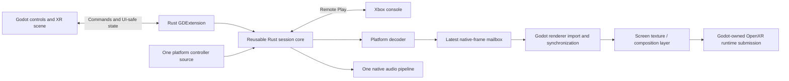

# XRBox Godot XR build plan

Updated: November 11, 2026. Planning baseline: desktop source **0.1.10**.

This is the execution plan for the selected Godot frontend. [Plan.md](Plan.md)
remains the overall product/progress plan; [ARCHITECTURE.md](ARCHITECTURE.md)
describes the implemented desktop code. Everything below is proposed unless
explicitly marked as current. The original plan created no runtime components; the progress section below
records subsequent implementation. Headset and APK validation remain pending.

## Implementation progress — Linux first

Implemented in this iteration: engine-neutral Notify and shared xrbox-core consumed
by the desktop app; godot-rust 0.5.5/API 4.7 extension; Godot 4.7.2 synthetic cinema
scene with controller/keyboard menus, bounded screen controls and recentering.
The extension reports native/core identity without starting auth or media.
See [xr/README.md](xr/README.md) for runnable commands and manual Linux checks.

M1 extraction is complete. M0/M2 are partial: engine/extension load and scene tests
pass on macOS; Linux ARM64 and Android ARM64 cargo checks pass. The Android extension now also links through NDK 29 and is packaged in a
debug-signed Quest 3S APK (0.1.10-xr.1), with static manifest/signature/ABI/alignment
checks passing. A Linux ARM64 export preset exists, but no linked Linux export
or Flatpak is built/validated. No target library has been launched on a headset. Linux cross-linker/sysroot and target
runtime access remain prerequisites; Docker was unavailable and was not started.
Native media, secure Android adapters and headset/battery tests remain pending.
The user has a Meta Quest 3S available while Steam Frame is shipping, so the next
manual device gate is Quest 3S; Linux remains a product/deployment target.
See [xr/ANDROID.md](xr/ANDROID.md) for APK build and installation instructions.

## 1. Decisions and first deliverables

Use **Godot 4 + OpenXR**, a minimal GDScript presentation layer, and an **in-process
Rust GDExtension** linked to the existing Rust/OpenXCloud core. Keep the native
desktop client as a regression harness. Do not port Xbox protocols to GDScript,
use Godot WebRTC for Xbox negotiation, or add a media server/helper process.

Two first-class headset artifacts are required:

| Target | Export / native ABI | First hardware acceptance |
| --- | --- | --- |
| Steam Frame | Godot Linux ARM64 export; matching Linux ARM64 Rust library | Extension loads, OpenXR initializes, synthetic screen appears and app shuts down cleanly |
| Meta Quest | Android APK, arm64-v8a; Rust aarch64-linux-android library | APK installs/launches in XR, extension loads, synthetic screen appears and lifecycle recovery works |
| Other Android OpenXR headsets | Shared source, generic/device/vendor export presets as required | Add each model only after actual installation, runtime and streaming tests |

Linux and Android ARM64 libraries are different ABIs. Meta is the first Android
test target, not the only intended Android target. Steam Frame Android/Lepton is
an optional additional preset; it must not silently replace the Linux deliverable.
The exact Quest model/OS must be recorded when hardware testing begins.

The first XR milestone is a **working deployment and media-integration prototype**,
not a polished room or a rewrite of every desktop menu. First prove the native
bridge and target exports, then hardware decode-to-Godot textures. Use synthetic
content until that path works; real Xbox/account testing is a separate gate.

## 2. Starting point and unresolved dependencies

Current desktop source has user-reported working console streaming, secure sign-in,
controller navigation, configurable deferred hotkeys, settings and fullscreen.
Latest extracted checks: 18 desktop + 27 core tests passed; Godot headless
scene/input tests passed. Formatting and strict Clippy passed. This does not establish
Linux ARM64, Android, Godot, XR, GPU-sharing or battery compatibility.

Remaining extraction/platform considerations (notification extraction is done):

- session.rs, media.rs and controller.rs now use engine-neutral Notify callbacks
  and existing snapshots in xrbox-core. The desktop adapter supplies egui repaints.
- NativeMediaPipeline and existing decoder/mailbox abstractions should be reused;
  media.rs currently selects VideoToolbox on macOS and FFmpeg otherwise. Android
  does not yet have a MediaCodec backend.
- xcloud-gpu contains desktop wgpu/egui presentation. Keep it with the desktop
  frontend; do not make the XR core depend on a second renderer/window.
- Current input construction selects the desktop native sampler. Android needs a
  tested Godot/native-event adapter, not assumed gilrs support.
- Current keyring, audio and native Opus dependencies need target-compilation
  audits. Android secure token storage is not implemented.
- The source now includes desktop, core and Godot-extension crates, seven vendored
  libraries and the xr/ project. The Android build template is now generated from the pinned engine under ignored
  xr/android; hosted CI is not present.

### Version qualification before pinning

Use released versions, matching engine/export templates and exact dependency pins.
Godot 4.7.2 and bindings 0.5.5/API 4.7 are now pinned and tested together on
macOS. OpenXR Vendors 5.1.0 is now staged from its checksum-pinned release for the
Meta export. Android build tools follow the actual 4.7.2 template: SDK 36,
Build-Tools 36.1.0, NDK 29.0.14206865, Gradle 8.11.1, AGP 8.6.1, Java 17.
These are build-tested, while target execution remains unverified:

| Component | Candidate / rule | Must verify in milestone 0 |
| --- | --- | --- |
| Godot | 4.7.2-stable pinned; macOS load tested | Required OpenXR/native-texture APIs, target exports and selected binding API compatibility |
| godot-rust / godot crate | 0.5.5 pinned with api-4-7; macOS load tested | Supported Godot API level, required public methods, Rust/toolchain compatibility and Android/Linux loading |
| OpenXR Vendors plugin | 5.1.0-stable candidate; release notes require Godot 4.6+ | Appropriate assets/features for the pinned engine and each device; no duplicate loaders |
| Rust | Existing project pin 1.99.1 | Native dependency compilation for chosen Android/Linux targets; never change the global default |
| Android toolchain | JDK/SDK/NDK/Gradle versions required by the selected Godot release | Read that release's build requirements, pin them and verify native link/export |
| Renderer | Mobile/Vulkan starting candidate | Godot Android XR guidance also advises Compatibility/OpenGL in some configurations; qualify per target alongside decoder import |

If this combination does not load cleanly, choose and document a compatible
released combination before adding features. Do not guess an api-4-x feature,
copy an obsolete NDK example, depend on moving Git branches, or enable unsafe/private
binding APIs simply to suppress errors. The initial pins and Mac archive hash are recorded in xr/toolchain.json;
add qualified platform toolchains there as implementation proceeds. A version table in this
plan is not a replacement for actual lockfiles or successful exports.

## 3. Ownership and data flow



| Owner | Responsibilities |
| --- | --- |
| Rust core | Authentication, discovery, home-only negotiation, WebRTC/channels, decoder/audio orchestration, controller/hotkey routing, settings validation, lifecycle state and diagnostics |
| GDExtension | Godot-visible control API, typed conversions, main-thread notifications and native texture/lifetime integration |
| Godot | Window/XR lifecycle, view poses, screen placement, menus/focus/navigation, composition-layer or mesh presentation and supported passthrough |
| Platform adapters | Hardware decoder/native surfaces, audio/device access, secure tokens and controller/lifecycle integration where existing components cannot be reused |

Godot owns the OpenXR session and graphics device used for its rendering. Rust must
not initialize a competing XR session or treat an unrelated wgpu/Vulkan device as
interchangeable. Workers never call Godot scene/render APIs from arbitrary threads.
No video or PCM goes through GDScript arrays, JSON, signals or localhost IPC.

### Proposed repository layout — create only when used

```text
crates/
  xrbox/                  existing desktop app and UI
  xrbox-core/             extracted reusable Rust modules and their tests
  xrbox-godot/            cdylib GDExtension, control bridge, texture integration
xr/
  project.godot           minimal Godot project
  export_presets.cfg     non-secret Linux/Android export presets
  scenes/                root, cinema screen, essential menus
  scripts/               thin scene/UI glue
  addons/                only required, version-pinned vendor/native integration
scripts/
  ...                    existing scripts retained
  ...                    add specific XR build/export checks as milestones need them
```

Keep decoder/platform modules inside an existing appropriate crate or the new
core/extension until a separate crate has a real build/ownership benefit. Do not
create empty platform packages, fake adapters or a generic presentation framework.
Add ignores for .godot caches, generated Android/build output, staged native
binaries, APKs and signing material before creating those artifacts.

## 4. Core extraction and bridge contract

Move functionality with minimal behavioral changes, keeping existing tests close
to their code. The desktop frontend must use the extracted core before the Godot
client starts real streaming. Use target features to exclude desktop UI, unsupported
keyring/input backends and irrelevant decoders from the APK dependency graph.

Use the existing bounded command and latest-state patterns. Replace egui repaint
calls with a non-blocking notification hook: the extension drains notifications
and reads the latest snapshot from a valid Godot thread. Preserve cancellation,
one active session, bounded teardown and protection against stale callbacks.

Proposed Godot-visible contract (names may be adjusted during implementation):

| Direction | Operations/data | Rules |
| --- | --- | --- |
| UI to core | Begin/cancel sign-in; discover; connect a discovered selection; disconnect; sign out | Validate current state and selection; no raw credentials supplied by scripts |
| UI to core | Validate/apply settings; open/close local menu; update app/XR focus | Reuse existing validation, deferred hotkeys and release rules |
| Core to UI | Auth state, console entries, connection stages, safe errors, settings and diagnostics | Send changes, not per-render-frame copies; keep queues bounded |
| Auth UI exception | Short-lived user code, approved verification URL, expiry | Needed for display/copy only; never expose the internal polling device_code, access/refresh/LPT tokens or log the user code |
| Platform to core | Raw controller state/events and lifecycle changes | One physical input owner; neutralize immediately on focus loss/disconnect |
| Renderer bridge | Current native frame lease, dimensions/color metadata/readiness | Native-only resource access; scripts receive a Godot texture/resource facade, not raw memory/driver handles |

Catch/translate Rust failures at the extension boundary; do not unwind through FFI
or continue with an invalid Godot object. Explicitly reject operations after shutdown.
Use cancellation/lifetime tokens so scene unload cannot leave callbacks targeting
freed resources. Do not enable editor hot reload of an extension with live GPU/media
resources until teardown behavior is proven.

### Controller ownership

Reuse the existing raw-state, shortcut and Xbox input serialization code. On Linux,
retain the tested native sampler if it works on Frame. On Android, choose one
platform/Godot input adapter and preserve button-up/disconnect events. Do not poll
independently through both Godot and gilrs, or assume a once-per-scene-frame poll
preserves fast taps or desired input timing. Continue bounded native packet timing.

Keep A-select/B-back for menus regardless of gameplay remapping. Preserve default
and custom shortcuts, first-Select/Start-release recognition, physical Guide
filtering and immediate unrelated gameplay inputs on resume. XR/headset system
buttons remain with the platform; no global shortcut suppression is required.

## 5. First Godot scene and UI

Start with built-in nodes/controls and a minimal scene. No room, dynamic lighting,
physics simulation, post-processing, upscaling or motion-controller gameplay.

```text
XRRoot
  XROrigin3D
    XRCamera3D
    CinemaScreen          composition-layer screen or unshaded mesh fallback
    MenuSurface           controller-focused controls, initially hidden in gameplay
  NativeSession           GDExtension-facing session owner/facade
  LifecycleCoordinator    focus, XR pause/resume and safe shutdown
```

Seated/local space is the starting reference; use floor/stage information only
when supported. Proposed initial screen defaults: 2 m distance, 2.4 m width, source
aspect ratio and eye-level placement. These are editable starting values, not
measured comfort recommendations. Provide distance/size, vertical position, recenter,
fit mode and reset. Default to world-locked placement; add head-lock only as an
explicit mode if needed. Keep a controller-accessible way to recover a misplaced
screen/menu, and test recentering after runtime reference-space changes.

Use Godot Control focus neighbors/action handling for the XR UI, backed by core
state/actions. Recreate only essential screens after the media prototype passes:

- Microsoft device code, verification URL, copy and cancel.
- Console tiles with current power/state and connect action.
- Stream menu: resume, XR display settings, mute, diagnostics and disconnect.
- Settings: existing supported preferences plus XR screen/recenter/passthrough options.
- Hotkey recording/reset with validation, clear focus and cancellation.

Composition-layer content must be tested in the headset; a desktop spectator view
may not show it. Use a fallback test view for development, not proof of XR output.
Do not rely on SubViewport's When Visible mode where composition-layer visibility
cannot be determined. Keep menu updates sparse where supported, but obey Godot and
runtime frame scheduling rather than stopping required XR submissions.

## 6. Hardware video and renderer integration

This is the highest-risk technical gate. First test synthetic H.264 at known
resolution/FPS, independently of Xbox auth/network conditions.

### Platform candidates

| Platform | Candidate media path | Not established yet |
| --- | --- | --- |
| Steam Frame Linux | A decoder actually exposed by the device/runtime; enumerate APIs/codecs and native surface formats | Which decoder API is accessible, export/import support, modifiers, synchronization and power |
| Android / Meta | MediaCodec H.264 hardware decoder with output Surface; evaluate a native-buffer path into the selected Godot renderer | Codec selection, buffer accessibility and Vulkan/AHardwareBuffer or EGL import on each target |
| macOS development harness | Existing VideoToolbox native buffers | Whether Godot's selected graphics backend can import them efficiently; desktop wgpu import is not automatically reusable |

Godot native-handle/RenderingDevice extension APIs are potential import hooks, not
a guarantee. Verify the supported public API and binding exposure. If a narrow
C++/JNI helper is necessary for a platform/engine API, keep it local to native
integration; do not move Xbox protocol ownership or add a second process.

### Frame lease and synchronization rules

Use the existing latest-frame mailbox, extending only native metadata needed by
the confirmed backend. Represent ownership explicitly through these transitions:

1. Decoder owns/fills a platform surface.
2. A bounded/latest-frame handoff retains the surface and readiness information.
3. The renderer imports or uses it on the correct device/queue after readiness.
4. GPU conversion/drawing/compositor submission retains every required resource.
5. Release/recycle only after the relevant GPU/compositor use is complete.

Acquiring/releasing an OpenXR swapchain image and releasing the decoder surface
are distinct events. Prove the actual lifetime on the Godot path. Test resize,
format changes, reconnect, pause, device loss and scene teardown with work in flight.
Never recycle a buffer just because the mailbox advances to the next frame.

Record pixel format, plane layout/stride, color range/matrix, native import handle,
GPU device/queue, readiness/completion primitives and required conversion passes.
Do not pass a VkImage between unrelated devices, assume Android buffers are NV12,
or advertise zero-copy based only on an available API. A documented GPU copy/color
conversion is acceptable; routine CPU readback/re-upload is not the efficient path.

If direct import is unavailable, evaluate a supported GPU conversion/renderer path.
A CPU diagnostic path may help isolate problems, but must be labeled and cannot
pass the efficiency gate. Keep the selected Godot frontend; investigate renderer,
decoder or narrow integration changes before considering an engine change.

## 7. Platform services and lifecycle

### Authentication and storage

Retain the existing supported Microsoft device-code flow and refresh-only durable
credentials. Browsers are for authentication, never media. Allow code entry on a
second device when useful; that device is not a streaming relay. Show return/resume
behavior clearly after headset browser switching.

Use Linux credential facilities only when actually available on Frame. For Android,
implement TokenStore with refresh credentials encrypted in app-private storage
using Android Keystore-protected keys; Keystore itself stores keys, not arbitrary
bearer tokens. If unavailable, offer a visible memory-only session. No plaintext
credential files or repeated persistence of temporary access/stream/transfer tokens.

### Audio

Retain native Opus decoding and one bounded native output pipeline. Verify the
existing backend on each target or add a narrow platform adapter. Do not route PCM
through GDScript or play it through both Godot and the core. Test output format,
underruns, mute/unmute, suspend, device changes and recovery. Disable unnecessary
engine audio processing for the video-only scene.

### Focus, pause and shutdown

Define explicit handling for window focus, OpenXR focus/visibility, headset removal,
Android pause/resume, browser switching, network loss, process recreation and quit.
Neutralize controls immediately whenever gameplay loses focus. Cancel hotkey capture
and pending input; do not replay stale buttons on return. Gate gameplay during menus.

Before live streaming, decide and document whether each lifecycle state keeps,
pauses or closes the session/audio/decoder and the bounded timeout for suspended
work. Do not silently reconnect forever. Show recovery status and offer reconnect.
Drain/cancel work without blocking the render thread, then release native surfaces,
textures, callbacks and session resources before extension/scene destruction.

### Optional runtime features

Query capabilities at runtime and keep a plain-background fallback. Add passthrough
only after a verified Godot/vendor extension path; Meta support does not imply
Frame or other-headset support. Treat foveation/eye tracking as later measured
optimizations. Foveating a 3D projection does not automatically reduce the video
decoder's workload or guarantee a cheaper compositor-layer path.

## 8. Build/export design

Build steps must be reproducible and explicitly target the correct ABI:

1. Check pinned tool versions and required files; fail clearly if prerequisites
   are missing. Do not install packages or change shell/global configuration.
2. Build/test the Rust core with platform-specific features; inspect dependencies
   to ensure no desktop window stack or unintended FFmpeg backend enters the APK.
3. Cross-build the cdylib and required native libraries for the selected target.
4. Stage the matching library and .gdextension mapping into the Godot project.
5. Import/check the project, then export with the pinned matching templates.
6. Inspect artifact architecture, native library references, notices and permissions.
7. Sign the requested artifact, report its version/hash and provide manual deployment
   steps. No automatic headset install, credential access or publication.

Prefer an explicit Linux ARM64 build environment/sysroot for Frame. Adding a Rust
target alone does not supply a compatible linker, libc and native Opus dependencies.
The Apple Silicon Mac remains useful for editor/core/Android development; do not
promise it can cross-build the complete Linux stack without that toolchain.

Use Godot's Android Gradle export flow with aarch64-linux-android / arm64-v8a
native libraries. Pin SDK/NDK/JDK/Gradle to the qualified engine release, not an
old documentation example. Export presets must configure OpenXR and required vendor
features without packaging duplicate loaders. Keep SDK paths and build overrides
explicit or command-local; signing secrets and debug/release keystores stay out of Git.
Release signing/store submission requires a later explicit user request.

Proposed presets: FrameLinuxArm64Debug/Release, MetaQuestDebug/Release, and a generic
AndroidOpenXRDebug profile for additional-device experiments. Only add presets when
their build path exists. A generic APK does not establish universal device support.

Implemented Make targets are xr-build, xr-check, xr-run and xr-preview.
Target/profile arguments for xr-build select native libraries; Linux/Android
export automation is not implemented. Other suggested target names below remain proposals. Preserve existing desktop targets;
do not change make build into an implicit app install/export. Document the target,
artifact path and expected device for every new task. Keep source, debug and release
artifacts clearly identifiable; test release exports when measuring performance.

### Linux release packaging: Flatpak

Target **Flatpak as the preferred Linux release format**, including a native
**aarch64** build for Steam Frame. Package the Godot export, matching Rust
GDExtension and required native libraries together. Keep an unpackaged Linux
export for bring-up and comparison; the Flatpak must pass the same XR/media gates.
Android continues to ship as an APK from the shared project.

Start by qualifying a supported org.freedesktop.Platform/SDK branch with aarch64
availability, compatible graphics extensions and the required native dependencies.
Pin the runtime branch and source inputs in a flatpak-builder manifest when this
build path exists. Include desktop/AppStream metadata, icons and GPL notices.
Choose a stable application ID before release so settings and credentials retain
consistent identities. An x86_64 package is a separate optional build, not an ARM64
compatibility layer. No manifest or Flatpak artifact exists yet.

The sandbox acceptance checklist is:

- Direct Xbox networking with explicit network sharing; authentication URL opening
  through the desktop portal. No helper outside the sandbox or streaming relay.
- GPU/render-node and decoder access, compatible driver libraries, native texture
  import and synchronization. Compare synthetic media inside/outside the sandbox.
- Host OpenXR runtime discovery, its native client libraries and required IPC paths
  on the actual Frame runtime. Do not bundle a second compositor or assume that
  granting GPU access makes a host XR runtime reachable.
- Audio output, controller input/disconnect and secure credential access with
  narrowly scoped permissions. Confirm which Flatpak version/input permission and
  Secret Service or portal path the chosen backends actually need.
- App-private non-secret settings/logs and working browser/focus/resume behavior.
  Avoid blanket host filesystem, session/system bus or all-device access as defaults.

Flatpak documentation verifies configurable sandbox access, not Steam Frame XR
compatibility. The actual loader/runtime, decoder and controller paths are device
qualification blockers. Test Flatpak early alongside the minimal Linux extension
export, before investing in release automation. Compare frame pacing and power
against the unpackaged build; packaging alone establishes neither a penalty nor
an efficiency improvement.

First produce a locally testable .flatpak bundle. Flathub submission is a later,
explicit publication step requiring current metadata, build and permission review;
Flatpak packaging does not automatically imply Flathub acceptance. Retain the
unpackaged diagnostic export if a sandbox issue needs investigation, and report
any blocker before treating the Linux release target as complete.

## 9. Milestones, small changes and stop boundaries

| Step | Concrete change/deliverable | Required evidence before moving on |
| --- | --- | --- |
| M0: qualify toolchain | Exact engine/binding/plugin/build-tool pins and target build notes | Public APIs available, minimal native library loads, ABI/toolchain gaps listed; no fabricated compatibility |
| M1: extract core | Rust core used by the existing desktop frontend, engine-neutral notifications and unchanged protocol ownership | Existing app/core regressions pass; no accidental runtime dependency/credential behavior changes |
| M2: Godot bridge and exports | Minimal screen/UI and native session facade, Linux ARM64 export and Meta debug APK | Extension initialization/teardown and OpenXR screen on actual target devices; user hardware test boundary |
| M3: synthetic hardware media | Native decoder/surface adapter and Godot texture import on each target | Named hardware decoder, correct color, paced frames, resource/synchronization evidence, copy path recorded |
| M4: essential live XR client | Supported auth/discovery/stream/menu/settings wired through bridge | Real console audio/video/input, direct-route evidence, controller/focus/lifecycle tests; user/account boundary |
| M5: compatibility and power | Other-headset presets, release exports and measured tuning | Per-device support matrix, reproducible artifacts, release-build pacing/power/temperature results |

Implementation-sized first changes:

1. Replace egui notification arguments with a small callback interface while the
   desktop app still owns the same rendering path; move/preserve affected tests.
2. Extract the minimum core and make the desktop app consume it; keep platform
   decoder/storage/input construction explicit and preserve settings compatibility.
3. Add the real extension entry point and minimal Godot project that can initialize,
   report native/core version/state and shut down. Avoid placeholder streaming calls.
4. Add one target export at a time, keeping the APK and Linux deliverables visible.
   Stop for extension/XR launch checks on real hardware before claiming support.
5. Implement/test one confirmed decoder-to-texture path with a synthetic clip.
   Do not start a full visual redesign while that gate remains unresolved.

These are planned changes, not authorization to install tools, launch the user's
console or publish binaries during this documentation task. Device bring-up can
proceed in either order; unavailable hardware must be reported rather than guessed.

## 10. Testing and measurable acceptance

| Layer | Automated checks | Manual/device checks |
| --- | --- | --- |
| Rust core extraction | Existing auth/session/input/settings/redaction tests; cancellation/cleanup; desktop adapter regression | Sustained desktop session when the user elects to test |
| Extension/control bridge | Fake services; valid/invalid commands; object/thread lifetime; unload with pending work; no secret logging | Real extension load on each OS/ABI |
| Godot UI | Headless scene/script import, focus neighbors, A/B actions, settings validation/capture, menu transitions and capability-disabled controls | Readability, recentering, screen placement and controller usability in headset |
| Graphics bridge | Synthetic frames/clips; mocked ownership and fence ordering; format/resize/resource bounds | Actual native import, colors, GPU validation and compositor presentation |
| Android services | Injectable storage/audio/input/lifecycle doubles; pause/restore and keystore failure paths | Native controller timing, secure persistence, device sleep, browser and audio recovery |
| Packaging | Inspect extension ABI/dependencies, manifest/export settings, signing separation and licenses | APK install/launch and Linux deployment on actual devices |

Headless success cannot establish video import, OpenXR composition output or power.
Do not disable hardware-sensitive assertions just to pass CI; separate those tests
and name the boundary. Do not run live account, Keychain, physical audio or console
tests automatically. Add CI incrementally once targets build; none exists now.
Keep existing dependency automation and add Android/action/plugin coverage when
those files are actually introduced, with manual compatibility review.

For each device build, record model, OS/firmware, OpenXR runtime/extensions, renderer,
codec/backend, source revision, build versions and release/debug mode. Capture
stream dimensions/FPS, received/assembled/decoded/presented/dropped frame counters,
queue/resource bounds, decode/import/conversion/presentation timing where measurable,
network RTT/loss where available, and CPU/GPU/memory/thermal/power counters.
Do not present unavailable counters as zero or decode timing as end-to-end latency.

Power trials use matched idle, local-video and Xbox-streaming runs unplugged on the
same headset with fixed brightness, volume, refresh, quality, network and thermal
starting conditions. Test passthrough separately. Avoid unnecessary lights, physics,
post-processing and redraws; keep headset refresh independent of stream FPS.
No numeric battery, latency or zero-copy claim is accepted without device evidence.

## 11. Open questions to resolve during implementation

- Exact qualified Godot/binding/vendor-plugin versions and API level.
- Actual Meta test model/firmware and other-headset availability.
- Exposed Linux hardware decoder and native surface/synchronization interfaces.
- Android Surface import path and renderer choice on each device.
- Whether composition layers improve pacing/quality/power for this video path.
- Correct native input, audio and credential backends per target.
- Runtime-specific pause/reconnect behavior and supported passthrough.
- Linux build environment and reproducible Android/native dependency toolchain.

Resolve each with a small test and record results. A problem in a backend is not
an automatic reason to abandon the chosen Godot frontend or replace Xbox protocols.

## 12. Completion checklist for the first XR prototype

- [ ] Exact version/toolchain pins and prerequisites documented without global changes.
- [ ] Desktop client still works through the extracted core; relevant tests pass.
- [ ] Godot extension loads and shuts down correctly on Linux ARM64 and Android ARM64.
- [ ] Steam Frame XR screen and Meta debug APK launch verified on actual hardware.
- [ ] Local H.264 uses an identified hardware decoder and documented native texture path.
- [ ] Controller navigation, local-menu gating and custom/deferred hotkeys preserved.
- [ ] Authentication/storage/audio/lifecycle adapters have meaningful automated tests.
- [ ] Credentials stay native and secure; only UI-required user codes cross to display.
- [ ] Artifacts include required native libraries/notices and separate signing inputs.
- [x] Hardware limitations and remaining live-console tests are explicit.

## Primary references checked for this plan

- [Godot release archive](https://godotengine.org/download/archive/)
- [godot-rust crate API/features](https://docs.rs/godot/0.5.5/godot/)
- [godot-rust Android export](https://godot-rust.github.io/book/toolchain/export-android.html)
- [OpenXR Vendors 5.1.0 release](https://github.com/GodotVR/godot_openxr_vendors/releases/tag/5.1.0-stable)
- [Valve: Godot on Steam Frame](https://partner.steamgames.com/doc/steamhardware/steamframe/engines/godot)
- [Godot XR setup](https://docs.godotengine.org/en/stable/tutorials/xr/setting_up_xr.html)
- [Godot Android XR deployment](https://docs.godotengine.org/en/stable/tutorials/xr/deploying_to_android.html)
- [Godot composition layers](https://docs.godotengine.org/en/stable/tutorials/xr/openxr_composition_layers.html)
- [Godot native texture creation](https://docs.godotengine.org/en/stable/classes/class_renderingserver.html#class-renderingserver-method-texture-create-from-native-handle)
- [Godot RenderingDevice](https://docs.godotengine.org/en/stable/classes/class_renderingdevice.html#class-renderingdevice-method-texture-create-from-extension)
- [Android MediaCodec](https://developer.android.com/reference/android/media/MediaCodec)
- [Android controller input](https://developer.android.com/games/sdk/game-controller/controller-input)
- [Android Keystore](https://developer.android.com/privacy-and-security/keystore)

- [Flatpak sandbox permissions](https://docs.flatpak.org/en/latest/sandbox-permissions.html)
- [Flatpak runtimes](https://docs.flatpak.org/en/latest/available-runtimes.html)
- [Flatpak command reference](https://docs.flatpak.org/en/latest/flatpak-command-reference.html)
